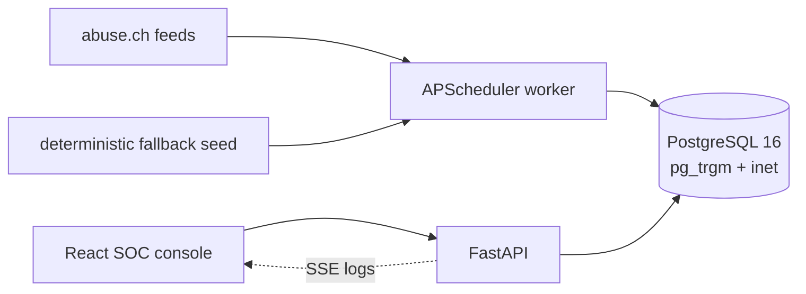

# IOC//FEED

A local-first IOC lookup and threat-intelligence console. It ingests up to 110,000 URLs, IPv4 addresses, domains, and hashes into PostgreSQL, exposes a FastAPI API, and presents investigations in a dark React SOC interface. No third-party threat service is queried during a lookup.

## Architecture



The worker is a separate process from the API. Feed adapters share a typed `IndicatorIn` normalization boundary and use PostgreSQL conflict handling to deduplicate `(type, value)` while retaining one source link per feed. The graph uses `react-force-graph-2d`: it is smaller and maps directly to the API's incremental node/edge expansion model; rendered neighborhoods are hard-capped at 250 nodes.

## Quick start

Requirements: Docker Desktop with Compose v2 and at least 4 GB available memory.

```bash
docker compose up --build
```

Open:

- SOC console: http://localhost:5173
- API documentation: http://localhost:8000/docs
- API health: http://localhost:8000/api/health
- PostgreSQL: `localhost:5432`

No `.env` file is required for the synthetic demo; copy `.env.example` to `.env` only when customizing it. On first boot the API waits for PostgreSQL, runs Alembic, and initializes data. With no `ABUSECH_AUTH_KEY`, it prints a warning and generates exactly `MAX_INDICATORS` deterministic synthetic rows (110,000 by default) across a three-year activity window. The operation is idempotent. The worker then refreshes feeds every 30 minutes or keeps the seeded demo available when credentials/network are absent.

## Real feeds and geo

Create a free abuse.ch Auth-Key from the authentication page at https://auth.abuse.ch/ and put it in `.env`:

```dotenv
ABUSECH_AUTH_KEY=your-key
```

The four independent adapters cover URLhaus, MalwareBazaar, ThreatFox, and Feodo Tracker. A failed adapter is logged and does not stop the others. Run an immediate refresh with `make ingest`.

For real IP geolocation, download a GeoLite2 City database from MaxMind, mount it into the API/worker containers, and set `MAXMIND_DB_PATH` to the in-container path. Without it, seeded IPs receive deterministic plausible coordinates and the globe shows a **SYNTHETIC GEO DATA** notice. Production deployments should add a read-only volume for the `.mmdb` to both services.

## Configuration

| Variable | Default | Purpose |
|---|---:|---|
| `DATABASE_URL` | Compose PostgreSQL URL | SQLAlchemy/psycopg connection |
| `POSTGRES_DB`, `POSTGRES_USER`, `POSTGRES_PASSWORD` | `ioc`, `ioc`, `change-me` | Database bootstrap |
| `ABUSECH_AUTH_KEY` | empty | Enables live ingestion |
| `MAX_INDICATORS` | `110000` | Global hard cap |
| `INGEST_INTERVAL_MINUTES` | `30` | Worker schedule |
| `MAXMIND_DB_PATH` | empty | Optional GeoLite2 City file |
| `FRONTEND_ORIGIN` | `http://localhost:5173` | Sole allowed CORS origin |
| `VITE_API_URL` | `http://localhost:8000` | Browser API base URL |
| `RATE_LIMIT_PER_MINUTE` | `120` | Per-client in-memory API limit |

Do not commit `.env`; it is ignored. Change the database password for any non-local deployment.

## Operations

```bash
make up        # build and run all services
make seed      # idempotently fill to MAX_INDICATORS
make ingest    # run every feed adapter once
make test      # backend and frontend tests in containers
make reset-db  # remove the named database volume and rebuild
```

The manual ingestion entry point is `python -m ingest.run --once`. API ingestion never runs inside the web process.

## Demo script

1. Search `10.0.0.1`, a deterministic seeded IPv4 IOC.
2. Open a result such as `http://node-3.malware-test.example/drop/4.bin`, expand graph nodes, select two nodes to request their shortest path, and open the risk drawer.
3. Use family, ASN, `/24`, and tag pivots in the drawer.
4. Open **IOC Atlas** to drill from year indexes into ordered month files, then select a day cell to filter the matching IOC rows.
5. Paste `10.0.0.1`, `node-2.malware-test.example`, and an unknown value into **Bulk Triage**, then export a format.
6. Open **Geo+Time**, choose Emotet, and play the timeline.

## Development and tests

Backend targets Python 3.11 and uses Ruff/pytest. Frontend uses strict TypeScript, ESLint, Prettier, and Vitest.

```bash
cd backend && pytest -q
cd frontend && npm install && npm run build && npm test -- --run
```

Database integration tests are guarded by `RUN_DB_TESTS=1`; `make test` inside a running Compose stack can enable it when full endpoint/dedup coverage is desired. Exact lookup uses the unique B-tree index, fuzzy search uses the `pg_trgm` GIN index, and all query inputs are length/range validated.

## API overview

Lookup/search, indicator detail, graph/expand/path, four pivot modes, bulk/export, stats, geo points, timeline, ingestion logs/SSE, and health endpoints live under `/api`. The authoritative interactive schema is at `/docs`.

